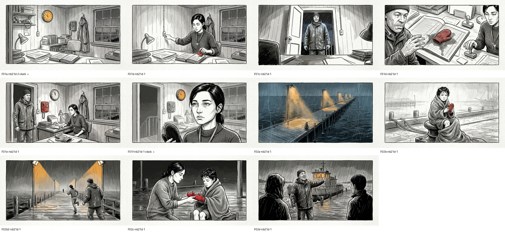

https://github.com/user-attachments/assets/e516dc0b-e776-4ade-a18e-55334b4edabd
# script2comic

Turn a finished screenplay into a motion comic you can watch: every line spoken by a distinct
voice, one ink drawing per visual beat, a slow push-in on each drawing, page turns, burned-in
subtitles, music and sound effects under it. Re-run after every rewrite without starting over.

It is pre-vis, pitch and table-read tooling. It is not the film.



**Watch the finished example before running anything:** 


https://github.com/user-attachments/assets/74139cda-fd09-446d-af43-3b1ccb1ad01b

(105 seconds, 9 MB).

The problem it solves: nobody reads a stranger's feature script, and a trailer cut from stock
proves nothing about the story. A three-hour, 64-part feature went through this pipeline for
about $46 in images plus a voice plan, and came out as three act videos, a five-minute pitch and
a table read with a reaction dial.

## What you get

- One video per board (an act, a sequence, a short), 1080p, HEVC or H.264.
- Subtitles burned in: dialogue with the speaker's name in gold, and with `--subs all` the
  narration too, so the clip reads with the sound off.
- A `timeline.json` for every audio cut: the start and end of every spoken line. Drawings, music
  and effects hang off it by the *text* of the line, never by a timestamp, so a rewrite re-times
  everything by itself.
- A listener cut: the same script with `[[skip]]` paragraphs dropped and headings shortened.
- A pitch cutter that reuses the same frames and voices under a new voice-over.
- A ledger of every request and what it actually cost.

## Install

Python 3.11+, `ffmpeg` and `ffprobe` on the PATH (an NVIDIA GPU makes assembly about five times
faster but is not required).

```
git clone https://github.com/manosamy/script2comic.git
cd script2comic
pip install -r requirements.txt
```

Keys go in `<project>/.env` (see `.env.example`) or the environment:

| Key | Used by | Where |
|---|---|---|
| `ELEVENLABS_API_KEY` | voices, music, sfx, voiceover | elevenlabs.io, any paid tier (Starter is $6/month) |
| `ATLAS_API_KEY` | board gen / edit | atlascloud.ai, pay as you go, $0.018 per image |

## Try the example first

`example/` is a complete project for a two-page scene, *The Last Ferry*. It ships with its
voices already rendered, its timeline, and the picked frames, so the assembly runs with no keys:

```
python s2c.py board --project example assemble ferry --subs all --no-music
```

That writes `example/out/the-last-ferry.mp4` (105 seconds, 11 frames) in about a minute. Then,
with keys, the same project from the top:

```
python s2c.py voices --project example --dry-run          # credit estimate, nothing spent
python s2c.py voices --project example --only all         # ~480 credits on a Starter plan
python s2c.py board  --project example gen ferry          # 11 images, $0.20
python s2c.py board  --project example sheet ferry        # contact sheet to review
python s2c.py board  --project example fix ferry          # redraw the two clocks
python s2c.py board  --project example assemble ferry --subs all --no-music
```

## Your own script

Make a directory and copy the example's files into it as a starting point:

```
my-film/
  .env                 keys (never committed)
  script.fountain      the screenplay, Fountain format
  cast.json            one voice per speaking character
  directions.json      per-line performance notes (optional)
  refs.yaml            who each character is, and their plate image in refs/
  style.yaml           the prompt style blocks (optional; the defaults are the example's)
  storyboards/*.yaml   one board per act or sequence: the frame list
  music.yaml sfx.yaml  themes, effects and where they go (optional)
  cache/  out/         generated audio, images, clips; finished videos
```

Then, in this order. Each step is cached: re-running after an edit only redoes what changed.

### 1. Voices: `s2c voices`

Render the script to audio **before you draw anything**. The timeline this writes is the clock
for everything else.

`cast.json` maps every speaking character to an ElevenLabs voice. Pick library voices by
archetype, give children a light voice pitched up, derive the rest:

```json
"MIRA":        {"voice_id": "EXAVITQu4vr4xnSDxMaL", "name": "Sarah"},
"TEO":         {"voice_id": "bIHbv24MWmeRgasZH58o", "name": "Will", "pitch_semitones": 4},
"RADIO VOICE": {"voice_id": "CwhRBWXzGAHq8TQ4Fs17", "name": "Roger", "fx": "radio"},
"YOUNG MIRA":  {"alias": "MIRA", "pitch_semitones": 3}
```

A character that appears in a new draft and is not cast yet gets an unused voice from `pool` and
is written back into the file, so a rewrite never stalls the render.

Direction has three layers, merged per line:

1. Parentheticals in the script map to audio tags: `(shouting)` becomes `[shouting]`, `(beat)`
   becomes `[pause]`. Staging parentheticals like `(kneeling)` are ignored.
2. `directions.json` for lines with no parenthetical. Entries match on character plus the first
   twelve or more characters of the line, so trailing edits do not orphan them:
   `{"character": "KOFI", "match": "Last ferry. All aboard.", "tags": "[warmly]"}`
3. A full replacement `text` with inline tags and pauses, for the hard lines.

Model notes, November 2026: `eleven_v4` for narration and dialogue. It follows compound tags like
`[low, gravelly voice]` and explicit `[pause]` / `[long pause]`. The previous and next line of the
same speaker are sent as context, or the performance resets every sentence. v4 accepts only three
stability values (0, 0.5, 1).

Cost: every clip is cached under a hash of engine, model, voice, settings, pitch, effect and
text. Change one word and one line re-renders. `--dry-run` prints the estimate; the measured rate
for v4 was 0.22 credits per character on pay-as-you-go and 0.40 on a Starter plan. A 137,000
character feature is 30,000 to 55,000 credits per clean render; the example's 1,200 characters
were 480.

Outputs: `out/<title>-narrated.mp3` (+ `.timeline.json`, `.scenes.txt`), `-dialogue.mp3`, and with
`--only all` the `-listener` cut. Script markers for the listener cut:

```
[[skip]] Mira runs the length of the pier. Kofi follows, slower.      (left out)
[[say: She takes the pier at a run.]] Mira runs the length of ...     (spoken as the short text)
```

### 2. The storyboard: `storyboards/<board>.yaml`

One entry per frame. One drawing per **beat**, not per scene: a new shot size, a new thing to
look at, a reaction. A 48-minute act needed 225 frames, about one every 13 seconds. A frame that
holds through three topic changes reads as a slideshow.

```yaml
id: ferry
output: the-last-ferry        # -> out/the-last-ferry.mp4
scenes: [1, 2]                # scene range of this board
anchor: F01b-nb21d-1.png      # an approved frame every later frame copies the style of
frames:
- id: F01d
  at: He drops a child's red mitten          # first words of the line it appears on
  scene: 1                                   # disambiguates repeated headings
  refs: [kofi, mira]                         # who is in it (refs.yaml)
  shot: close on the desk, two figures soft at the edges of the frame
  focus: the small wet mitten (red)          # the ONE accent colour; also the push-in target
  prompt: A child's small wet mitten dropped onto the open ledger ...
```

Rules that cost re-renders to learn:

- **No timestamps anywhere.** `at:` is a text prefix. Timestamps go stale on the first edit.
- Never anchor a frame on a one-line shout. A 1.1-second line vanishes under its own page turn.
  Anchor on the action paragraph. A beat needs about four seconds.
- A scene's first frame comes up with the scene chime, not three seconds later.
- `offset: 12` puts a second drawing twelve seconds into a long paragraph.
- `still: true` turns off the push-in for a run of near-identical frames.
- `multi: true` drops the one-face rule when the script needs copies of a character; the prompt
  must say the count out loud.
- `tint: storm` switches on a named wash from `style.yaml` (a dream, a memory, another world).
- `text: "V. NATARAJAN"` is the only lettering allowed in the panel; otherwise none.
- `post: {clock: "11:53", cx: 597, cy: 186, r: 46}` redraws clock hands at the true angle. No
  image model aims clock hands; the dial finder wants a big dial, so give a small one its centre.
- `turn: dissolve` or `turn: cut` replaces the page turn into that frame.
- Period scenes: write the wardrobe into every prompt. Modern reference plates win otherwise.

### 3. Frames: `s2c board gen`, `sheet`, `edit`, `fix`

The model is an image editor with reference inputs (`google/nano-banana-2.1-developer/edit` on
Atlas Cloud, $0.018 per image). Inputs per frame: one front plate per character in `refs`, plus
the board's `anchor` frame as a style reference. The prompt is built from fixed blocks and the YAML:

```
[STYLE]   Hand-drawn black ink line art ... MONOCHROME ink except for ONE accent color ... 16:9.
[ONCE]    Each named character appears exactly ONCE in the panel; never duplicate a figure.
[TINT]    (only with tint:) This panel is seen through rain on glass: ...
[REFS]    image 1 = KOFI: a ferry captain in his 50s ... Draw this exact person ONCE, in ink ...
[SCENE]   <prompt from the YAML>
[SHOT]    <shot from the YAML>
[ACCENT]  ACCENT COLOR only on: <focus>. STRICT: nothing else in the panel has any color ...
[TEXT]    No text, letters, numbers, captions, speech bubbles, logos or watermarks anywhere.
```

Plates: a photo of an actor, a generated portrait, or an ink drawing you approved. The example's
three plates were drawn by the model from the `desc` alone and then used as references for every
frame. One front plate per person, never a turnaround sheet: a sheet makes the model draw the
person twice.

The failures repeat, and each has a one-sentence fix:

| Failure | Fix |
|---|---|
| Two of the same character | One front plate per character; the once-rule |
| Colour leaks onto a dress or window | The STRICT sentence in the accent block |
| An invented date or word on a board | Say "smudged, illegible", or give the exact words in `text:` |
| A person in a frame that should be empty | Say "EMPTY, no people anywhere in the panel"; the plates pull people in |
| A map of worlds drawn as Earth | "abstract web of nodes, NOT a map of Earth, no continents" |
| Clock hands at 10:10 | `post: {clock: ...}` and `s2c board fix` |

Review with `sheet` (a contact sheet; `--all` shows every candidate), set `pick:` in the YAML
for the roll you want. For a stray trait or a missing prop use `edit`:
`s2c board edit ferry F01e "remove the lamp"` makes a new candidate from the pick, same drawing
minus the thing, two cents. This replaces most re-rolls.

### 4. Assembly: `s2c board assemble`

For each frame, ffmpeg makes one clip from the still: a push-in from zoom 1.00 to 1.10 toward the
accent colour's centroid, for the length of the beat. Page turns are 0.6-second `xfade`
transitions. Subtitles are burned in with libass. Music themes loop and duck under every voice
line; effects are cued by the text of a line, like frames.

```
zoompan=z='1+0.10*on/N':d=N:x='iw*cx-iw/zoom/2':y='ih*cy-ih/zoom/2':s=1920x1080
```

Three things that matter at scale:

- Do not build one filter graph for an act. Thirty inputs into xfade used 7 GB and stalled.
  Each beat and each page turn is its own small clip, encoded in parallel, joined with the concat
  demuxer and `-c copy`, then one linear pass for subtitles and audio.
- Every clip is keyed by a hash of its source image, its beat length and the encoder. A script
  edit re-times the beats; a new pick re-encodes one clip; nothing else moves.
- Use the GPU. NVENC was about five times faster than x264 on a laptop 4060. Benchmark on an idle
  machine: under load the first measurement showed 1.5x.

Music and effects: `music.yaml` lists themes (generated once by `s2c music`, ElevenLabs Music)
and cues by scene range; `sfx.yaml` lists effects (`s2c sfx`, ElevenLabs Sound Effects) and cues
by line text. The example ships both files with the cues commented out; generate, then uncomment.

### 5. A pitch cut: `s2c voiceover` + `s2c pitch`

Write the pitch narration as a text file, render it with `s2c voiceover pitch/pitch.json` (it
writes an `.srt` from ElevenLabs' character timings), then list shots in a cue YAML: a board frame
or an image, which audio starts there (a voice-over passage, or a cached cast line from the
script), holds, music and effects. `s2c pitch pitch/pitch.yaml` assembles it with the same push-in
and page turns. Run either tool with `-h` for the fields.

## What it is for

**The pitch.** Five minutes from the same frames and voices, re-timed to a new voice-over.

**The table read.** Viewers watch an act with a one-to-five dial in hand and leave a note at each
break. The result was not what I expected: the sag was never pacing. Every trough lined up with a
note saying some form of "what does she want here". I had been cutting length when the problem
was motivation. People are polite in words and honest with a thumb.

**Pre-vis.** The frame list is a shot list with a shot size on every row. Hand it to a
cinematographer and the conversation starts at frame 40, not at page 1.

## Mistakes, in order

1. Started on a $0.08 image model. The $0.018 one matched it on a three-frame test.
2. Held frames too long. A 43-second hold was the first note I got.
3. Let modern reference plates win over period wardrobe.
4. Built one monster filter graph.
5. Benchmarked the GPU on a busy machine.

## What I would keep

Text prefixes instead of timestamps. One accent colour doing three jobs. Every rendered clip
cached by hash. The whole board in one YAML you can diff.

## Layout of this repo

```
s2c.py                   the command: s2c voices | board | music | sfx | voiceover | pitch
script2comic/project.py  the project directory and .env
script2comic/voices.py   Fountain parser, casting, directions, ElevenLabs, cache, stitch, timeline
script2comic/board.py    frames: prompt builder, Atlas Cloud, contact sheet, edit, clock fix, assembly, mixer
script2comic/music.py    themes from music.yaml           script2comic/sfx.py   effects from sfx.yaml
script2comic/voiceover.py  a standalone narration + .srt   script2comic/pitch.py cue-list assembly
example/                 The Last Ferry: script, cast, directions, refs, board, rendered voices, picked frames
```

Built for [The Invisible Hand](https://theinvisiblehandmovie.com), a feature screenplay.
If you build one of these from your script, send it to me on X: [@mano_samy](https://x.com/mano_samy).
I will watch all of it.

MIT licence.
